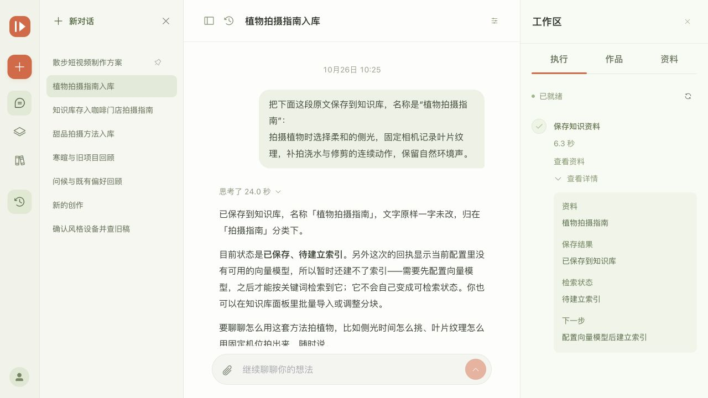
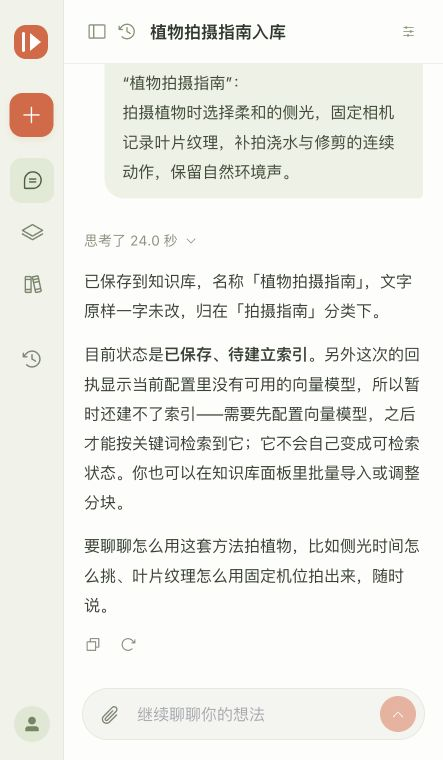

# 短视频内容智能策划与文案生成系统

Vue 3 + Element Plus 创作工作台，Spring Boot 业务服务，Python LangGraph Agent 与 RAG，MySQL 8.x、Redis 和 Qdrant。

## 演示截图

### 对话创作工作台（桌面）



### 对话创作工作台（窄屏）



更多知识库、作品管理和管理端截图见 [`docs/ui-preview/`](docs/ui-preview/)。截图展示本地演示界面，不代表线上服务已部署。

## 项目目录

```text
short-video-agent-frontend/   Vue3 TypeScript Vite Element Plus
short-video-agent-backend/    Java21 Spring Boot REST API
short-video-agent-ai/         Python FastAPI LangGraph Qdrant
compose.yaml                 六个服务的一体部署
run.sh / run.bat             macOS、Linux / Windows 本地服务菜单
scripts/                     环境初始化和端到端验证
docs/                        架构、接口、配置与测试说明
```


## 本地启动

```sh
bash run.sh
```

macOS 首次使用可双击根目录 **`setup-mac.command`**，或执行 `bash run.sh setup`，安装缺少的环境后打开服务菜单。直接运行 `bash run.sh` 也会检测环境，缺失时提供一键安装选项。`bash run.sh check-env` 仅检查，不安装或启动服务。

安装器支持 Apple Silicon / Intel：Python 3.12、OpenJDK 21、Node.js 24、MySQL 8.4、Redis、Maven；已有兼容环境会复用，已有 MySQL 8.0 不会升级到 8.4。没有 Homebrew 时自动安装 Homebrew，清华镜像优先、官方源回退。首次安装可能需要输入 Mac 登录密码，或在 Apple 弹窗中完成命令行工具安装，脚本会等待完成后继续。版本分支固定，补丁版本由 Homebrew 提供。

环境路径只在项目脚本内生效，不改 shell 配置，也不强制替换系统默认 Java、Node 或 Python。环境安装不启动数据库；从菜单选择启动项目时才启用 MySQL、Redis。已有数据库密码保留，需在 `.env.local` 配置正确账号。

Windows 双击根目录 `run.bat`，或在终端执行 `run.bat`。两个入口均先检测服务状态并显示本地访问地址，支持上下/左右方向键选择、回车确认，也可输入编号：1 启动或停止项目、2 刷新状态、3 查看日志、4 取消退出、5 环境与依赖详情；macOS 另有 6 安装 / 修复运行环境。打开菜单不会自动启动或停止任何服务。

菜单默认分开展示服务状态、运行环境汇总、项目依赖汇总，缺失或不兼容项单独标出；详情页展示各软件版本与路径。启动前会重新校验环境。启动与安装过程中顶部固定显示汇总，下方滚动显示最新安装日志，完整输出保存在 `.runtime/local/install.log`。

确认启动后才安装所需依赖、构建并生成缺失的 `.env.local`。MySQL、Redis 未运行时尝试启动已安装的系统服务；停止项目时保持这两个常驻服务运行。前后端启动失败会显示原因、日志位置与最近日志。本机数据库账户与端口在 `.env.local` 配置。

本地脚本默认优先使用 npmmirror（npm）、清华 PyPI、阿里云 Maven；安装失败会回退官方源。配置仅作用于本次安装，Maven 临时设置保存在 `.runtime/local/`，不会修改全局源。Qdrant 1.15.5 优先通过 `ghfast.top` 加速下载，再回退 GitHub，解压前核对官方发布的 SHA-256；不再连续重复请求同一个失效地址。

可在 `.env.local` 覆盖 `LOCAL_NPM_REGISTRY`、`LOCAL_PIP_INDEX_URL`、`LOCAL_MAVEN_MIRROR`、`LOCAL_GITHUB_PROXY`。将 `LOCAL_GITHUB_PROXY` 留空可直连 GitHub；已有离线包可通过 `LOCAL_QDRANT_BIN` 指定可执行文件路径。镜像选择不会触发已缓存依赖的重新安装。


```sh
bash run.sh start --demo
bash run.sh status
bash run.sh stop
```

Windows 同样支持 `run.bat status`、`run.bat start`、`run.bat stop` 和 `run.bat logs backend`。Windows 系统服务管理需要相应权限；全部路径由脚本所在目录确定，项目文件夹可以移动，也可以从其他工作目录调用入口。

前端默认 http://127.0.0.1:5178 。真实模式需配置生成模型；知识检索还需独立配置 Embedding。显式 demo 模式只验证界面与业务链路，不代表真实模型质量。详细配置见 [本地运行](docs/LOCAL_RUN.md)。

## Docker 部署

```sh
./scripts/setup-env.sh
docker compose up -d --build
```

容器前端默认 http://localhost:8088 。管理员初始化凭据位于 `.env`。部署说明见 [deploy/README.md](deploy/README.md)。

## 功能

首页为对话式创作工作台：连续讨论需求，通过 2～5 个选项讨论选题、表达方向、观众、风格和制作方式；点击选项先填入输入框，确认后再发送，也可直接输入其他想法。Agent 按消息选择工具，执行过程实时显示，创作结果包含脚本分镜、拍摄、配音和剪辑方案，可继续局部改稿、手动编辑、比较与恢复版本、定稿及导出。

保留用户注册登录、原有任务与作品、知识引用和个人信息管理。每个账户拥有可编辑的默认知识库，可添加资料、启停、重建索引、测试检索和恢复预置内容。管理员从左下角账户菜单进入独立管理端，提供账户概览与用户启停、角色管理；返回用户端后恢复创作工作台。

对话支持 Word、PDF、PowerPoint 等文档上传、自动标题、聊天摘要、可编辑用户画像与历史作品读取。作品和对话共用可收起侧栏，详见 [连续创作工作区](docs/WORKSPACE_V3.md)。

最新交互与知识库说明见 [对话入库与独立双侧栏](docs/WORKSPACE_V5.md)，管理端说明见 [独立管理端](docs/WORKSPACE_V4.md)。

新闻检索、原文链接和文稿式作品编辑见 [新闻驱动的连续创作](docs/WORKSPACE_V6.md)。个人设置、创作默认值与记忆清理见 [个人设置与记忆生命周期](docs/WORKSPACE_V7.md)。

## 验证

```sh
cd short-video-agent-frontend && npm ci && npm test && npm run build
cd ../short-video-agent-backend && mvn test
cd ../short-video-agent-ai
python3 -m venv .venv
.venv/bin/pip install -r requirements-dev.txt
.venv/bin/python -m pytest
```

运行中的系统可执行端到端验证，管理员密码通过环境变量传入：

```sh
SMOKE_ADMIN_PASSWORD='本地管理员密码' python3 scripts/smoke_test.py
SMOKE_ADMIN_PASSWORD='本地管理员密码' python3 scripts/conversation_smoke.py
```

脚本会创建测试用户、知识资料和任务；知识测试资料会删除，任务保留供检查。请在开发或测试数据库运行。

## 文档

- [本地启停脚本](docs/LOCAL_RUN.md)
- [对话式 Agent 工作台设计](docs/AGENT_WORKSPACE_DESIGN.md)
- [测试结果与待验收事项](docs/TESTING.md)
- [配置和后续所需模型 API](docs/CONFIGURATION.md)
- [部署与数据保留](deploy/README.md)
- [系统架构与功能边界](docs/ARCHITECTURE.md)
- [接口契约](docs/API_CONTRACT.md)
- [对话与制作包接口](docs/CONVERSATION_API.md)
- [演示知识资料](docs/examples/knowledge-demo.md)

本机已接入 `qiniu/conatus-free`，真实对话、选题工具、完整制作包及局部改稿已验证。浏览器已完成本轮桌面与窄屏检查；Embedding 与真实知识库检索质量仍需独立验收，见测试记录。

管理员可在独立管理后台的“模型接入”中热保存对话模型、OpenAI 兼容地址和密钥，详见 [模型接入设置](docs/MODEL_SETTINGS.md)。
