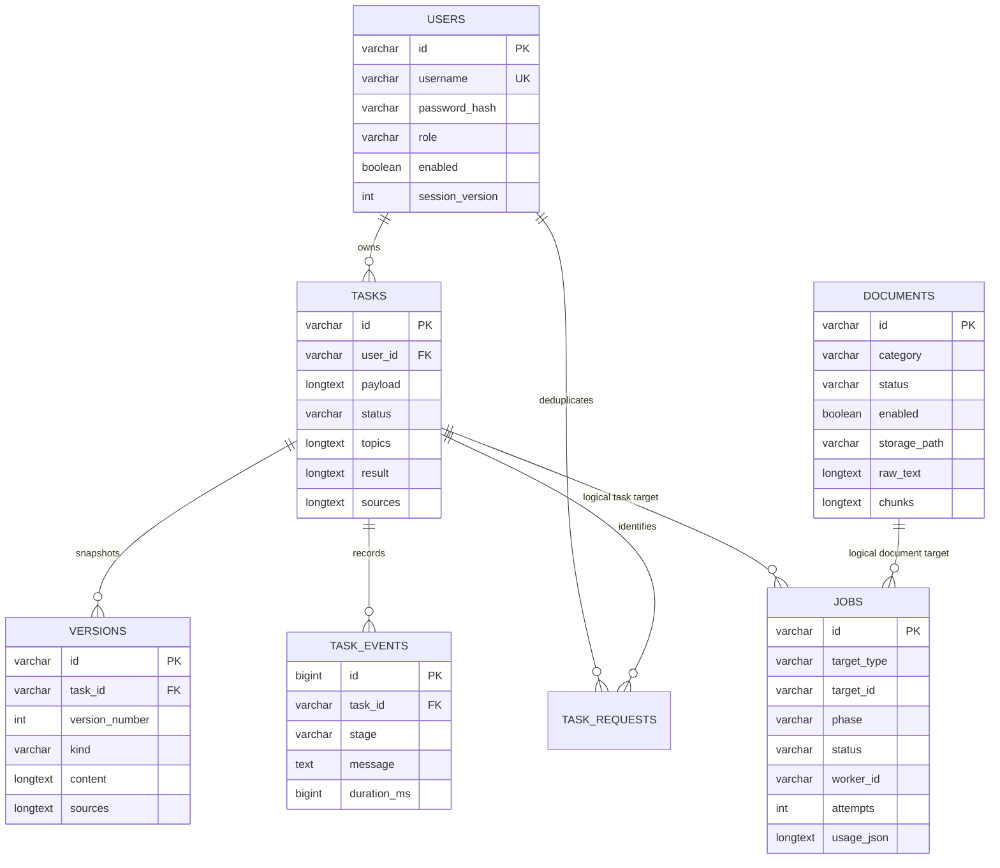

# Short Video Agent Backend

Java 21、Spring Boot 3.5、Spring JDBC、Flyway、MySQL 8.x、Redis 7。所有业务接口位于 `/api`，接口定义见上级 `docs/API_CONTRACT.md`。后端是用户、权限、任务、版本和资料状态的唯一业务入口，AI 服务只接受后端的内部调用。

## 本地启动

先准备 MySQL 8.x 数据库和 Redis，启动 Python AI 服务。根据实际环境配置：

```sh
export DB_URL='jdbc:mysql://127.0.0.1:3306/short_video_agent?useUnicode=true&characterEncoding=utf8&serverTimezone=UTC&forceConnectionTimeZoneToSession=true'
export DB_USERNAME='shortvideo'
export DB_PASSWORD='设置数据库密码'
export REDIS_HOST='127.0.0.1'
export REDIS_PORT='6379'
export REDIS_PASSWORD='设置Redis密码'
export AI_BASE_URL='http://127.0.0.1:8000'
export AI_INTERNAL_KEY='与AI服务配置相同的随机内部密钥'
export KNOWLEDGE_DIR='/绝对路径/共享知识库目录'
export SEED_ADMIN_USERNAME='admin'
export SEED_ADMIN_PASSWORD='自行设置强密码'
mvn spring-boot:run
```

生成模型和 Embedding 的供应商密钥只配置在 Python 服务；Java 无需接触供应商密钥。`KNOWLEDGE_DIR` 必须在 Java 和 Python 两端对应同一绝对路径或共享挂载点。默认端口为 8080，可用 `SERVER_PORT` 修改。根目录的 Docker Compose 已提供完整部署编排。

管理员种子环境变量默认为空，不会创建默认密码账号。两项同时配置且用户名尚不存在时才创建管理员；不会覆盖已有账号密码或自动提升同名普通用户。创建后可以移除种子配置。

## 构建与测试

```sh
mvn test
mvn package
java -jar target/short-video-agent-backend-1.0.0.jar
```

测试使用 H2 MySQL 兼容模式运行真实 Flyway 迁移和业务服务，Redis 命令用内存 mock，不需要真实 API key。覆盖账号禁用、密码修改后的会话失效、用户资源隔离、持久化任务队列、幂等任务创建、选题确认、不可变版本和局部优化字段保护。H2 检查不能替代 MySQL 8.x 与完整 AI 服务的端到端验收。

## 持久化与执行

- MySQL 保存用户、任务输入、生成内容、版本、引用快照、运行事件、执行作业和 Token 用量。版本包含完整内容与当时引用，删除知识资料不破坏历史作品。
- Redis 保存 7 天有效的随机不透明会话。Redis 中仅保存 token 的 SHA-256 键；每次请求还检查数据库中的 enabled、role 和 session_version。密码修改、管理员停用/更改权限会使旧会话失效。
- 登录和注册按 IP/用户名限流；创作按用户限流。操作密码使用 BCrypt，密钥不会进入业务响应。
- 异步任务先在 MySQL 中排队，再由有界执行器处理，默认并发 2（`AI_WORKERS`，最高 8）。Redis 资源锁和数据库条件更新共同防止重复领取。任务状态和阶段结果均落盘。
- 心跳每 15 秒更新执行租约。失去心跳超过 16 分钟的 RUNNING 作业重新排队。进程重启后等待租约到期即可恢复；生成请求的读超时为 360 秒。不会在网络调用期间持有数据库事务。
- 一次运行失败后可显式重试。API 配置缺失或供应商失败会显示失败原因，不会替换成伪造结果。演示模式必须在 AI 服务明确开启。
- 创建任务可以附带 `Idempotency-Key` 请求头（用户内唯一，最多 100 字符），重复请求返回原任务。其他修改操作在锁定任务行后检查运行状态，运行时拒绝重复提交。
- 元数据修改、资料删除和重建索引共用 Redis DOCUMENT 资源锁。上传文件仅支持 TXT、MD、DOCX、PDF，20MB 上限；文件名改为 UUID，原名仅用作显示。

## 数据关系



`jobs.target_id` 为 TASK 或 DOCUMENT 的逻辑引用；删除资源前显式清理对应作业。内容和引用用 JSON 文本列保存，便于版本快照及结构演进，业务查询条件使用独立字段与索引。

## 边界

普通用户仅能访问自己的作品（包括版本、导出、修改、删除），管理员列表可查看任务概要。没有内置跨用户代编辑权限。文件系统与数据库应共同备份。HTTP API 本身不启用跨域，前端经同源 Nginx `/api` 代理；部署时由 HTTPS 入口承载用户访问。

管理健康接口 `/api/admin/health` 报告 AI、MySQL 和 Redis 可用性及模型是否配置，不返回配置密钥。公开 `/api/health` 只表示 Web 进程已启动。

## 时区

数据库会话和 JDBC 连接统一使用 UTC：`serverTimezone=UTC&forceConnectionTimeZoneToSession=true`。仅配置 `serverTimezone=UTC` 不会改变 MySQL 会话时区；当服务器运行在 Asia/Shanghai 时，会导致读取 `TIMESTAMP` 产生 8 小时偏差。API 使用带 `Z` 的 ISO 时间，前端按浏览器本地时区显示。修正连接参数只改变会话和时间解释，无需修改已有 TIMESTAMP 数据。自定义 `DB_URL` 时也必须保留这两个参数，H2 测试不受影响。

可选 MySQL 实机回归测试：配置 `MYSQL_TIMEZONE_TEST_URL`、`MYSQL_TIMEZONE_TEST_USERNAME`、`MYSQL_TIMEZONE_TEST_PASSWORD` 后运行 `mvn -Dtest=MySqlTimezoneTest test`。测试仅创建连接级临时表，不改业务记录。

## 注册限流与反向代理

`REGISTRATION_MAX_ATTEMPTS`（默认 `10`）与 `REGISTRATION_WINDOW_SECONDS`（默认 `3600`）控制每个客户端 IP 的注册频率。格式错误或缺少必填信息的请求不消耗注册配额；超过配额返回 HTTP 429，响应消息显示 Redis 窗口实际剩余秒数，并附带 `Retry-After` 响应头。本地批量验收可设置 `REGISTRATION_MAX_ATTEMPTS=100`，生产默认保护保持 10 次/小时。

服务使用 Tomcat 原生 `RemoteIpValve` 处理可信代理转发，Java 认证代码只使用已经处理后的 `request.getRemoteAddr()`。默认仅信任 IPv4 私有网段与回环地址作为代理，以及 IPv6 回环地址；公网直接请求的 X-Forwarded-For 不被信任。Nginx 应覆盖 `X-Forwarded-For` 为 `$remote_addr`（不要拼接客户端提供的值）。后端端口仅向代理开放；若有特殊代理地址，可通过标准 Spring 配置 `SERVER_TOMCAT_REMOTEIP_INTERNAL_PROXIES` 收紧为实际代理地址的正则表达式。

## 对话创作工作台

Flyway V2 增加 `conversations`、`conversation_messages`、`agent_runs`、`run_events`、`artifacts`、`artifact_versions` 和 `conversation_requests`，原任务接口保持兼容。新接口定义见上级 `docs/CONVERSATION_API.md`。

- 会话、消息、选项、需求摘要和制作方案均保存在 MySQL。每组 A/B/C 选项由服务端生成独立 UUID，提交时必须匹配当前用户所属会话的已保存消息和 OPEN 选项组；D 自定义须提供非空文本。新的同类选项会使旧的未选选项失效，已确认选项不能再次改选。
- 提交消息时通过会话行锁拒绝并发执行；`Idempotency-Key` 防止重复消息生成。已确认选项立即写入需求摘要，然后创建持久化 QUEUED run。每轮上下文最多 40 条消息、总计约 10 万字符，避免无限历史请求。
- 新 worker 通过 Redis 会话资源锁和 MySQL 条件状态领取作业。Python 返回 NDJSON，工具开始、完成、失败和助手文本增量逐条落盘。SSE `/stream?after=<eventId>` 及 GET `/events` 从持久事件序号重放；断开页面不会停止生成，重新连接继续读取。SSE 只接受 Bearer 请求头，定期重新核验会话令牌，禁止将令牌放入 URL。
- 上游每轮最多 300 秒，HTTP 请求超时为 360 秒。用户取消会先将 run 标为 CANCELLED 并清除 activeRunId，随后关闭上游连接；所有迟到事件和最终结果在事务内检查当前 run，不能覆盖作品或插入最终回复。
- 作品更新先暂存于本轮内存，收到有效 final 后才将内容、不可变版本和助手回复原子提交。未完成、取消或失败的更新不会覆盖已有版本。作品校验与 Python 严格结构一致，包括 UUID 分镜、字段长度和列表数量限制。
- 局部修改由 Java 再次按实际工具 scope 合并。opening、titles、voiceover、shooting、editing、duration 和指定分镜只允许改变各自区块；时长修改保留分镜 ID 和其他内容。已有资料引用快照保留，避免停用或删除知识资料破坏历史作品。
- 手动修改必须携带当前 `baseVersion`，版本已更新时返回 409。恢复旧版本与定稿都创建新版本，完整 Markdown/TXT 导出包含脚本、分镜、拍摄、配音、剪辑和资料来源。
- 执行心跳丢失超过 16 分钟时，将中断 run 标为 FAILED，并保存可见失败说明。用户重新发送需求后才开始新一轮，不自动重复消耗模型调用。排队中的 run 在进程恢复后继续领取。

新增测试覆盖会话所有权、选项和自定义输入、失效选项、消息幂等、乐观版本、取消后迟到写入拦截、工具事件先落盘、范围保护及真实本机 HTTP NDJSON 逐条读取。没有真实模型密钥时，这些测试验证业务协议与机制，不证明模型质量。
